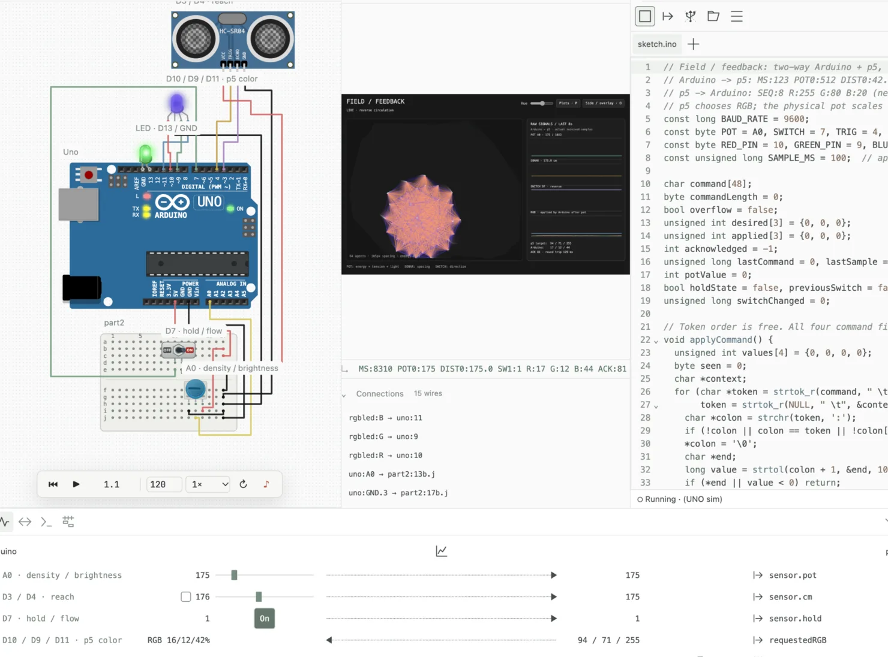

# p5comp

p5comp lets you build a virtual Arduino circuit and use its signals in a [p5.js](https://p5js.org/) sketch. Try a ready-made example in your browser, change the wiring or code, and watch what happens. You can start without an Arduino or any installation.

**[Open p5comp](https://languel.github.io/p5comp/)** · [Follow the getting-started lesson](docs/getting-started.md)

*Field / feedback. Arduino reads the sensors, the p5 sketch responds, and p5 sends color commands back to the RGB LED.*

## Try your first circuit

1. Open [p5comp](https://languel.github.io/p5comp/). If another project is open, save it first, then choose **File → Examples → Getting started → HelloLED**.
2. Click **Run Arduino + p5**. Watch the LED in the circuit and the circle in the p5 preview blink together. The Arduino sketch sends a message each time the LED changes.
3. Click **Stop simulation**, then halve both delay values in the Arduino editor. If the editor is hidden, open **Code editors**. Click **Run Arduino + p5** again and watch the LED and the circle blink faster.

Open **File → Examples → Getting started → LED from scratch · recorded lesson** to watch the circuit and both sketches being built, step by step. Then try **Four signals**, or load the [Field / feedback example](docs/field-feedback.md) shown above and move the simulator’s potentiometer slider.

When you want to keep your changes, use **File → Save** to export the project. To connect a physical board over USB, use desktop Chrome or Edge and follow the hardware instructions in the guides below.

## Guides

- [Getting started](docs/getting-started.md) walks through three examples from blinking an LED to building a feedback loop.
- [Workspace and circuit reference](docs/workspace-reference.md) covers wiring, simulation tools, Arduino and p5 editors, drawing, USB, and Firmata.
- [Simulation and lessons](docs/simulation-and-lessons.md) describes supported boards and parts. [Arduino ↔ p5 communications](docs/arduino-p5-communications.md) explains how the two sketches exchange data.
- [Developer setup](docs/development.md) covers local servers, tests, deployment, and publishing class examples. See also [browser compilation](docs/browser-compilation.md) and the [optional local compiler](docs/local-compiler.md).
